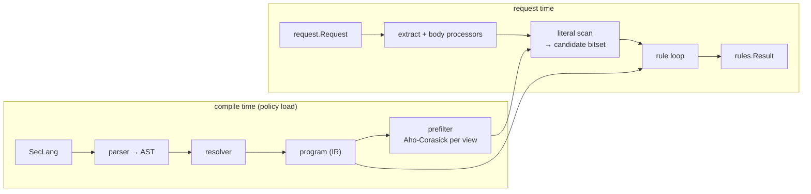

# 0007 — Inkwall Rule Engine

- Status: Draft
- Date: 2026-10-04
- Owner: noureldin
- Depends on: [0001](0001-performance-first-architecture.md) (budgets, measurements), [0002](0002-system-architecture.md) §3.1, [0005](0005-component-map.md) §6
- License: Apache-2.0, like the rest of the data plane

Inkwall's own CRS evaluator, to reach the 0001 budgets Coraza cannot. Coraza stays as oracle and
fallback.

**Built (v0.1.0):** none of the engine; evaluation uses Coraza (`pkg/rules/coraza`). The CRS suite
(`test/crs`) and the prefilter feasibility tool (`test/perf/prefilter`) exist.
**Not yet:** `pkg/rules/native`, `test/diff`, `--engine`, shadow mode.

## Contents

- [1. Summary](#1-summary)
- [2. Why](#2-why)
- [3. Goals and non-goals](#3-goals-and-non-goals)
- [4. Architecture](#4-architecture)
  - [4.1 Compiler](#41-compiler)
  - [4.2 Runtime](#42-runtime)
  - [4.3 Prefilter and normalization views](#43-prefilter-and-normalization-views)
  - [4.4 Supported SecLang subset](#44-supported-seclang-subset)
- [5. Verification](#5-verification)
- [6. Performance targets](#6-performance-targets)
- [7. Integration](#7-integration)
- [8. Code layout](#8-code-layout)
- [9. Milestones](#9-milestones)
- [10. Risks](#10-risks)
- [11. Open questions](#11-open-questions)

---

## 1. Summary

Compile CRS (SecLang) ahead of time into a flat program, then evaluate with:

1. **One literal scan per field** to select candidate rules; the rest skip transforms and regex.
2. **Lazy, shared transformations** without maps: decode only for candidates, reuse results across
   rules sharing a chain prefix.
3. **Zero-allocation, interruptible runtime:** pooled transactions, slices, deadline checks between
   rules.

Detection must be **identical** to Coraza's (rule IDs, scores, block decisions). Target: benign
requests at 50–100 µs, 5–10× faster than Coraza.

## 2. Why

Coraza 3.8.1 + CRS 4.25, PL1, one core (0001 §3.1, §5.2): benign GET ~0.51 ms (budget ≤ 0.15 ms
p50); JSON with 150 fields ~29 ms (budget ≤ 0.5 ms per 8 KB). Causes:

- Every rule runs on every field; Coraza's regex prefilter misses attacks (CRS 942220-2, 932311-7)
  and is disabled.
- Transformations run before the operator; the map-based transform cache costs ~25%.
- ~2,800 allocations per request (~14% GC); no interruption (hence admission control).

At PL1, 100 of 104 per-argument rules have a required literal and 90.5% of benign rule-field
evaluations can be skipped (`test/perf/prefilter`). Overriding `@rx` from outside saves only ~30%;
the rest needs the rule loop.

## 3. Goals and non-goals

Goals:

1. **Parity** with Coraza on pinned CRS v4: same interruption and score; with early exit off
   (§4.2), same rule IDs. Deliberate deviations go in a reviewed allowlist with a reason and test.
2. 0001 engine-time budgets, near-zero allocations.
3. Bounded work: linear-time matching, size caps, deadline checks.
4. Implement `pkg/rules.Evaluator`, so adapters and pipeline don't change.
5. Fall back to Coraza on unsupported features.

Non-goals (v1): full SecLang (pinned CRS plus a documented custom-rule subset); phases 3–5
(response, audit log; later with T4); a general ModSecurity replacement.

## 4. Architecture



Compiled once per bundle; immutable, shared, swapped atomically (0001 §5.1).

### 4.1 Compiler

- **Parser:** AST with file/line positions; any unsupported feature is a named compile error, so
  `auto` falls back (§7).
- **Resolver:** `SecDefaultAction`, configure-time exclusions, rule-group pruning, `skipAfter` →
  indexes. **Paranoia gating is constant-folded:** in pinned CRS only setup rules write the
  paranoia `tx` variables, so rules above the level are removed; if any other rule writes them,
  folding is off.
- **IR:** flat rules per phase with compiled selectors, a chain ID into a transformation trie
  (shared prefixes share work), compiled operator and actions, chain links, required literals.
- **Prefilter:** required literals (any match contains one) → one Aho-Corasick automaton per view.

### 4.2 Runtime

- Transactions from `sync.Pool`; collections as slices, no maps on the hot path.
- Extract variables once per phase; one Aho-Corasick pass per field and view sets candidate bits.
- Rule loop: skip non-candidate fields; transformed values from per-field memo slots indexed by
  chain-prefix ID (lazy, capped per request); operator, then actions; deadline check every N
  rules. Single operator calls aren't interrupted, so field size caps bound the longest step.
- **Early exit** (block mode, off by default): stop once the score reaches the threshold. It
  changes reported rules, so parity tests, shadow and detect mode never use it.
- **Body processors:** URL-encoded, JSON (Coraza names like `json.items.0.sku`), XML, multipart
  with CRS's strict flags. Ported from Coraza (attributed) for parity.
- **Regex:** Go `regexp` (RE2, same as Coraza, so same semantics), Coraza's `(?sm)` defaults;
  libinjection via `corazawaf/libinjection-go`.

### 4.3 Prefilter and normalization views

Literals must match transformed values without running transformations, so each field gets a few
views, computed once:

| View | Computed as | Covers chains with |
|---|---|---|
| `raw` | case-folded only | no decoders (rules matching `%u`, `\x` themselves) |
| `decoded` | URL (incl. `%u`) + HTML-entity decode, NULs removed, case-folded | these decoders, case changes |
| `cmdline` | `decoded` + `cmdLine` | `cmdLine` (RCE) |
| `nospace` | `decoded`, no whitespace | `removeWhitespace` |
| `nocomments` | `decoded`, no comments | `replaceComments` / `removeComments` |

A rule uses a view that **dominates** its chain (literal in transformed value ⇒ literal in view),
proven by property tests and fuzzing; otherwise it filters after transformation (sound, saves only
operator time). Soundness rules:

- **Case folding, not lowercasing:** `(?i)select` matches `ſelect`; `ToLower` misses it. Map runes
  to a canonical fold-orbit member (`unicode.SimpleFold`).
- **No over-decoding:** a view never decodes more than its chain, or literals in encoded form are
  lost.
- **Never prefiltered:** negated operators, `multiMatch` rules (unless every intermediate value is
  dominated), and operators not implied by a literal (numeric, `validate*`, libinjection,
  `within`).

This is the central risk, gated by N3: zero violations on CRS payloads, benign, Unicode fold-variant
and fuzz corpora. The feasibility tool has 0 violations in ~2.1M checks at PL1 and ~3.9M at PL4;
plain lowercasing failed on 2 rules at PL1 and 5 at PL4.

### 4.4 Supported SecLang subset

Pinned CRS defines the minimum; a CI check (N0) fails on any unsupported feature, so CRS upgrades
can't silently lose rules, and produces the authoritative list. Indicative:

| Area | v1 support |
|---|---|
| Directives | `SecRule`, `SecAction`, `SecMarker`, `SecDefaultAction`, `SecRuleRemoveById/ByTag`, `SecRuleUpdateTargetById/ByTag`, `SecComponentSignature` (ignored), body config |
| Variables | `ARGS*`, `ARGS_NAMES*`, `ARGS_COMBINED_SIZE`, `REQUEST_HEADERS*(_NAMES)`, `REQUEST_COOKIES*(_NAMES)`, `REQUEST_URI(_RAW)`, `REQUEST_FILENAME`, `REQUEST_BASENAME`, `REQUEST_LINE`, `REQUEST_METHOD`, `REQUEST_PROTOCOL`, `QUERY_STRING`, `REQUEST_BODY(_LENGTH)`, `FILES*`, `FILES_COMBINED_SIZE`, `MULTIPART_*`, `REQBODY_ERROR*`, `XML:/*`, `TX`, `MATCHED_VAR(S)(_NAME(S))`, `UNIQUE_ID`, `REMOTE_ADDR`; `&`, `:key`, `:/regex/`, `!` |
| Operators | `rx`, `pm`, `pmFromFile`/`pmf`, `streq`, `contains`, `beginsWith`, `endsWith`, `within`, `eq`/`ge`/`gt`/`le`/`lt`, `ipMatch(FromFile)`, `validateByteRange`, `validateUrlEncoding`, `validateUtf8Encoding`, `detectSQLi`, `detectXSS`, `unconditionalMatch`, `!` |
| Transformations | ~25: `none`, `lowercase`, `urlDecode(Uni)`, `htmlEntityDecode`, `jsDecode`, `cssDecode`, `cmdLine`, `compressWhitespace`, `removeWhitespace`, `removeNulls`, `replaceNulls`, `removeComments`, `replaceComments`, `normalizePath(Win)`, `utf8toUnicode`, `base64Decode(Ext)`, `hexDecode`, `sqlHexDecode`, `escapeSeqDecode`, `length`, `trim(Left/Right)` |
| Actions | `id`, `phase`, `msg`, `logdata`, `tag`, `severity`, `ver`, `t:`, `chain`, `block`, `deny`, `pass`, `allow`, `drop`, `status`, `setvar`, `capture`, `multiMatch`, `skipAfter`, `(no)log`, `(no)auditlog`, `ctl:ruleRemoveById/ByTag`, `ctl:ruleRemoveTargetById/ByTag`, `ctl:requestBodyProcessor`, `ctl:ruleEngine`, `ctl:forceRequestBodyVariable`; `rev`, `maturity`, `accuracy` ignored |

## 5. Verification

Parity is the product:

1. **CRS suite** (`test/crs`, built): same 4,572 tests as Coraza.
2. **Differential tests** (`test/diff`): same IDs, scores, interruption on CRS payloads, benign
   corpus, recorded traffic and fuzzing.
3. **Component conformance:** each transformation and body processor fuzzed byte for byte against
   Coraza.
4. **Shadow mode:** both evaluators on sampled traffic, `inkwall_engine_disagreements_total{rule_id}`;
   enable per policy after a clean period. Off the request path, own slot budget, dropped first
   under load.

Plus the prefilter soundness check in CI.

## 6. Performance targets

One core, PL1, gated by `benchstat` in CI (0001 §8):

| Request | Target | Coraza today |
|---|---|---|
| Benign GET | ≤ 100 µs p50 | ~510 µs |
| Benign form POST, 2 fields | ≤ 120 µs | ~740 µs |
| JSON, 150 fields | ≤ 3 ms | ~29 ms |
| Allocations, benign GET | ≤ 50 | ~2,800 |

Attacks may cost more (rare; bounded by admission control). Provisional: header/URI rules
(920/921) weren't measured; N0 measures them, N3 confirms the targets.

## 7. Integration

- `pkg/rules/native` implements `rules.Evaluator`; `pkg/rules/coraza` stays.
- Policy `engine: native | coraza | auto` (`--engine` standalone); `auto` falls back to Coraza with
  a logged reason.
- `--engine-shadow coraza --shadow-sample 0.01` reports disagreements, never changes the verdict.
- Default `coraza` until N5, then `auto`.

## 8. Code layout

```
pkg/rules/native/
├── seclang/   compile/   program/   prefilter/
├── transform/ operators/ bodyproc/  runtime/
└── evaluator.go   # rules.Evaluator
test/diff/         # differential harness (separate module, imports Coraza)
```

- Ported Coraza code keeps its copyright header and is listed in `NOTICE`.
- **Starts in this repo:** engine, pipeline and test harnesses change together.
- **Own module** (e.g. `github.com/inkwall-dev/engine`) only when it is the default (N5), its API
  has been stable, and there is a reason (an embedder, or per-CRS release cadence).
- **Keep that move mechanical:** imports only `pkg/request` and `pkg/rules` (`depguard`), all code
  and tests under the directory; extract with `git filter-repo --subdirectory-filter`.
- Coraza is never removed: it stays oracle and fallback.

## 9. Milestones

| # | Milestone | Exit criteria |
|---|---|---|
| N0 | Parser + IR for pinned CRS, no execution | 100% of pinned CRS compiles; paranoia folding verified |
| N1 | Transformations and operators | Byte-for-byte conformance fuzzing against Coraza |
| N2 | Runtime, phases 1–2, no prefilter, URL-encoded bodies | CRS suite at PL1 on GET/form; differential tests clean |
| N3 | Prefilter, views, lazy transforms | 0 soundness violations; §6 GET and form targets met |
| N4 | JSON, XML, multipart | Full CRS request suite; JSON target met |
| N5 | `--engine`, `auto` fallback, shadow mode | Clean shadow period; default becomes `auto` |
| N6 | PL2–4, custom-rule docs, response phases (T4) | CRS suite at PL4 with response tests |

N3 is go/no-go: it measures the gain before the parity long tail. The fallback makes each milestone
useful alone.

## 10. Risks

| Risk | Impact | Mitigation |
|---|---|---|
| Semantic drift from Coraza | Bypass, false positives | Differential fuzzing; CRS gate; shadow mode |
| View doesn't dominate its chain | Bypass | Property tests; post-transform filtering; CI soundness check |
| Case-folding mismatch (`ſ`/`s`, `K`/`k`) | Bypass | Canonical fold mapping; fold-orbit corpus |
| Over-decoding loses encoded literals | Bypass | `raw` view; views never decode more than chains |
| Coraza's own parity bugs | Same false negatives | Reviewed allowlist; CRS suite as reference |
| New CRS feature | Lost rules | CI coverage check; `auto` fallback |
| Multipart edge cases | Bypass | Port Coraza's processor; fuzz; CRS 922xxx |
| Maintenance cost | Slower CRS upgrades | CRS-only subset; port, don't reinvent |
| Targets missed | Little gain for the cost | N3 measures early |

## 11. Open questions

1. Bundles (0002 §4.3) carry the compiled program or SecLang? Compile cost decides (N0); a program
   must be signed and tied to the engine version.
2. Early exit on by default in block mode? Or finish evaluation asynchronously for reporting.
3. Optional `go-re2` (cgo) backend behind a build tag?
4. Which SecLang features do custom rules need beyond CRS? Ask design partners before N6.
