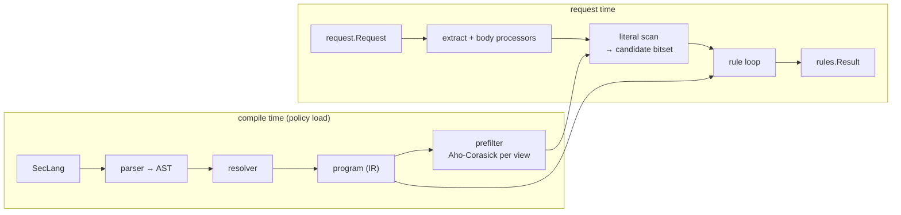

# 0007 — Inkwall Rule Engine

- Status: Draft
- Date: 2026-10-04
- Updated: 2026-10-30
- Owner: noureldin
- Depends on: [0001](0001-performance-first-architecture.md) (budgets, measurements),
  [0002 §3.1](0002-system-architecture.md#31-inkwall-engine-data-plane),
  [0005 §6](0005-component-map.md#6-why-coraza)
- License: [Apache-2.0](https://www.apache.org/licenses/LICENSE-2.0), like the rest of the data plane

The engine (`inkwall-engine`) evaluates rules with [Coraza](https://coraza.io/) today, and Coraza cannot reach the
latency budgets of [0001](0001-performance-first-architecture.md). This document designs
Inkwall's own **rule engine** for the [OWASP Core Rule Set](https://coreruleset.org/) (CRS): the part of the engine that
evaluates rules, behind the `pkg/rules.Evaluator` interface. We call it the **native** rule engine
(`pkg/rules/native`). Coraza stays as the **oracle**, the reference whose results the native rule
engine must reproduce, and as the fallback.

**Built (v0.1.0):** none of the native rule engine; evaluation uses Coraza (`pkg/rules/coraza`).
The CRS test suite (`test/crs`) and the prefilter feasibility tool (`test/perf/prefilter`) exist.
**Not yet:** `pkg/rules/native`, `test/diff`, `--engine`, shadow mode.

## Contents

- [1. Summary](#1-summary)
- [2. Why](#2-why)
- [3. Goals and non-goals](#3-goals-and-non-goals)
- [4. Architecture](#4-architecture)
  - [4.1 Compiler](#41-compiler)
  - [4.2 Runtime](#42-runtime)
  - [4.3 Prefilter and normalization views](#43-prefilter-and-normalization-views)
  - [4.4 Supported SecLang subset](#44-supported-seclang-subset)
- [5. Verification](#5-verification)
- [6. Performance targets](#6-performance-targets)
- [7. Integration](#7-integration)
- [8. Code layout](#8-code-layout)
- [9. Milestones](#9-milestones)
- [10. Risks](#10-risks)
- [11. Open questions](#11-open-questions)

---

## 1. Summary

Compile the CRS, written in [ModSecurity](https://github.com/owasp-modsecurity/ModSecurity)'s rule language ([SecLang](https://coraza.io/docs/seclang/)), ahead of time into a flat
program. Then evaluate it with:

1. **One literal scan per field** to select the candidate rules. The other rules skip their
   transformations and regexes.
2. **Lazy, shared transformations, without maps:** decode a value only for candidate rules, and
   reuse the result across rules whose transformation chains share a prefix.
3. **A zero-allocation, interruptible runtime:** pooled transactions and slices, and deadline
   checks between rules.

Detection must be **identical** to Coraza's: the same rule IDs, scores and block decisions. The
target is 50–100 µs for a benign request, 5–10× faster than Coraza.

## 2. Why

Measured with Coraza 3.8.1 and CRS 4.25 at [paranoia level](https://coreruleset.org/docs/concepts/paranoia_levels/) 1 (PL1), on one core
([0001 §3.1](0001-performance-first-architecture.md#31-measured-baseline-2026-10-03),
[0001 §5.2](0001-performance-first-architecture.md#52-rule-evaluation)):

- a benign GET takes about 0.51 ms, against a budget of 0.15 ms at p50;
- JSON with 150 fields takes about 29 ms, against a budget of 0.5 ms per 8 KB.

The causes:

- Every rule runs on every field. Coraza's regex prefilter misses attacks (CRS tests 942220-2 and
  932311-7), so it is disabled.
- Transformations run before the operator, and the map-based transformation cache costs about
  25%.
- About 2,800 allocations per request, so about 14% of the time goes to [garbage collection](https://go.dev/doc/gc-guide).
- Evaluation can't be interrupted, which is why admission control is needed.

At PL1, 100 of the 104 rules that run per argument have a required literal, and 90.5% of the
benign rule-and-field evaluations can be skipped (`test/perf/prefilter`). Overriding Coraza's
`@rx` operator from outside saves only about 30%. The rest of the gain needs control of the rule
loop.

## 3. Goals and non-goals

Goals:

1. **Parity** with Coraza on the pinned CRS v4: the same interruption and score, and, with early
   exit off ([§4.2](#42-runtime)), the same rule IDs. Deliberate deviations go in a reviewed
   allowlist, each with a reason and a test.
2. Meet the engine-time budgets of [0001](0001-performance-first-architecture.md), with nearly zero
   allocations.
3. Bounded work: [linear-time matching](https://github.com/google/re2/wiki/WhyRE2), size caps, deadline checks.
4. Implement `pkg/rules.Evaluator`, so the adapters and the pipeline don't change.
5. Fall back to Coraza on unsupported features.

Non-goals for v1:

- Full SecLang. We support the pinned CRS plus a documented subset for custom rules.
- [Phases](https://coraza.io/docs/seclang/execution-flow/#phases) 3–5 (response and audit log). They come later, with tier T4 (response inspection).
- A general replacement for ModSecurity.

## 4. Architecture



The program is compiled once per [bundle](../glossary.md#bundle) (the signed set of policies the engine enforces). It is
immutable and shared, and swapped in atomically
([0001 §5.1](0001-performance-first-architecture.md#51-process-model)).

### 4.1 Compiler

- **Parser:** builds an [abstract syntax tree](https://en.wikipedia.org/wiki/Abstract_syntax_tree) (AST) with file and line positions. Any unsupported
  feature is a named compile error, so the `auto` setting falls back to Coraza
  ([§7](#7-integration)).
- **Resolver:** turns `SecDefaultAction`, configure-time exclusions, rule-group pruning and
  `skipAfter` into indexes.
- **Paranoia gating is constant-folded.** In the pinned CRS, only setup rules write the paranoia
  `tx` variables, so the rules above the configured level are removed at compile time. If any
  other rule writes those variables, folding is off.
- **[Intermediate representation](https://en.wikipedia.org/wiki/Intermediate_representation) (IR):** flat rules per phase. Each rule has compiled selectors, a
  chain ID into a transformation [trie](https://en.wikipedia.org/wiki/Trie) (shared prefixes share work), a compiled operator and
  actions, chain links, and its required literals.
- **Prefilter:** a rule's required literals are strings that every match contains. They go into
  one [Aho-Corasick](https://en.wikipedia.org/wiki/Aho%E2%80%93Corasick_algorithm) automaton per view ([§4.3](#43-prefilter-and-normalization-views)).

### 4.2 Runtime

- Transactions come from a [`sync.Pool`](https://pkg.go.dev/sync#Pool). Collections are slices: no maps on the hot path.
- Variables are extracted once per phase. One Aho-Corasick pass per field and view sets the
  candidate bits.
- **Rule loop:**
  - skip fields for which the rule isn't a candidate;
  - take transformed values from per-field memo slots, indexed by chain-prefix ID (filled lazily,
    capped per request);
  - run the operator, then the actions;
  - check the deadline every N rules.

  A single operator call isn't interrupted, so the field size caps bound the longest step.
- **Early exit** (block mode only, off by default): stop once the score reaches the threshold.
  It changes which rules are reported, so parity tests, shadow mode and detect mode never use it.
- **Body processors:** URL-encoded, JSON (with Coraza's names, such as `json.items.0.sku`), XML,
  and multipart with CRS's strict flags. They are ported from Coraza, with attribution, for
  parity.
- **Regex:** [Go](https://go.dev/)'s [`regexp`](https://pkg.go.dev/regexp) ([RE2](https://github.com/google/re2/wiki/Syntax), as in Coraza, so with the same semantics), with Coraza's `(?sm)`
  defaults. [libinjection](https://github.com/libinjection/libinjection) through [`corazawaf/libinjection-go`](https://github.com/corazawaf/libinjection-go).

### 4.3 Prefilter and normalization views

Literals must match the transformed values without running the transformations. So each field
gets a few **views**, computed once:

| View | Computed as | Covers chains with |
|---|---|---|
| `raw` | Case-folded only | No decoders (rules that match `%u` or `\x` themselves) |
| `decoded` | URL decoding (including `%u`) and HTML-entity decoding, NULs removed, case-folded | These decoders, and case changes |
| `cmdline` | `decoded`, then `cmdLine` | `cmdLine` (remote command execution rules) |
| `nospace` | `decoded`, without whitespace | `removeWhitespace` |
| `nocomments` | `decoded`, without comments | `replaceComments` / `removeComments` |

A rule uses a view that **dominates** its transformation chain: if the literal is in the
transformed value, it is in the view. Property tests and [fuzzing](https://go.dev/doc/security/fuzz/) prove each such claim. A rule
with no dominating view is filtered after its transformations instead; that is still sound, but
saves only operator time.

Soundness rules:

- **Case folding, not lowercasing.** `(?i)select` matches `ſelect`, but `ToLower` misses it. Map
  each rune to a canonical member of its fold orbit ([`unicode.SimpleFold`](https://pkg.go.dev/unicode#SimpleFold)).
- **No over-decoding.** A view never decodes more than the rule's chain does, or literals written
  in encoded form are lost.
- **Never prefiltered:**
  - negated operators;
  - `multiMatch` rules, unless every intermediate value is dominated;
  - operators that a literal doesn't imply: numeric ones, `validate*`, libinjection, `within`.

This is the central risk. Milestone N3 (prefilter, views and lazy transformations;
[§9](#9-milestones)) gates it: zero violations on the CRS payload, benign, Unicode fold-variant and
fuzz corpora. The feasibility tool found 0 violations in about 2.1M checks at PL1 and about 3.9M at
PL4. Plain lowercasing failed on 2 rules at PL1 and 5 at PL4.

### 4.4 Supported SecLang subset

The pinned CRS defines the minimum. A CI check, built in milestone N0 (parser and IR,
[§9](#9-milestones)), fails on any unsupported feature, so a CRS upgrade can't silently lose rules.
That check also produces the authoritative list. Indicative:

| Area | v1 support |
|---|---|
| Directives | `SecRule`, `SecAction`, `SecMarker`, `SecDefaultAction`, `SecRuleRemoveById/ByTag`, `SecRuleUpdateTargetById/ByTag`, `SecComponentSignature` (ignored), body configuration |
| Variables | `ARGS*`, `ARGS_NAMES*`, `ARGS_COMBINED_SIZE`, `REQUEST_HEADERS*(_NAMES)`, `REQUEST_COOKIES*(_NAMES)`, `REQUEST_URI(_RAW)`, `REQUEST_FILENAME`, `REQUEST_BASENAME`, `REQUEST_LINE`, `REQUEST_METHOD`, `REQUEST_PROTOCOL`, `QUERY_STRING`, `REQUEST_BODY(_LENGTH)`, `FILES*`, `FILES_COMBINED_SIZE`, `MULTIPART_*`, `REQBODY_ERROR*`, `XML:/*`, `TX`, `MATCHED_VAR(S)(_NAME(S))`, `UNIQUE_ID`, `REMOTE_ADDR`; `&`, `:key`, `:/regex/`, `!` |
| Operators | `rx`, `pm`, `pmFromFile`/`pmf`, `streq`, `contains`, `beginsWith`, `endsWith`, `within`, `eq`/`ge`/`gt`/`le`/`lt`, `ipMatch(FromFile)`, `validateByteRange`, `validateUrlEncoding`, `validateUtf8Encoding`, `detectSQLi`, `detectXSS`, `unconditionalMatch`, `!` |
| Transformations | About 25: `none`, `lowercase`, `urlDecode(Uni)`, `htmlEntityDecode`, `jsDecode`, `cssDecode`, `cmdLine`, `compressWhitespace`, `removeWhitespace`, `removeNulls`, `replaceNulls`, `removeComments`, `replaceComments`, `normalizePath(Win)`, `utf8toUnicode`, `base64Decode(Ext)`, `hexDecode`, `sqlHexDecode`, `escapeSeqDecode`, `length`, `trim(Left/Right)` |
| Actions | `id`, `phase`, `msg`, `logdata`, `tag`, `severity`, `ver`, `t:`, `chain`, `block`, `deny`, `pass`, `allow`, `drop`, `status`, `setvar`, `capture`, `multiMatch`, `skipAfter`, `(no)log`, `(no)auditlog`, `ctl:ruleRemoveById/ByTag`, `ctl:ruleRemoveTargetById/ByTag`, `ctl:requestBodyProcessor`, `ctl:ruleEngine`, `ctl:forceRequestBodyVariable`; `rev`, `maturity`, `accuracy` are ignored |

## 5. Verification

Parity is the product. It is checked four ways:

1. **CRS test suite** (`test/crs`, built): the same 4,572 tests Coraza passes.
2. **Differential tests** (`test/diff`): the same rule IDs, scores and interruption as Coraza on
   CRS payloads, the benign corpus, recorded traffic and fuzzing.
3. **Component conformance:** each transformation and body processor is fuzzed byte for byte
   against Coraza's.
4. **Shadow mode:** both rule engines run on sampled traffic, and
   `inkwall_engine_disagreements_total{rule_id}` counts where they differ. A policy switches to the
   native rule engine after a clean period. Shadow evaluation runs off the request path, with its
   own budget of evaluation slots, and is the first work dropped under load.

The prefilter soundness check also runs in CI.

## 6. Performance targets

On one core, at PL1, gated by [`benchstat`](https://pkg.go.dev/golang.org/x/perf/cmd/benchstat) in CI
([0001 §8](0001-performance-first-architecture.md#8-proving-it-the-performance-test-harness)):

| Request | Target | Coraza today |
|---|---|---|
| Benign GET | ≤ 100 µs p50 | ~510 µs |
| Benign form POST, 2 fields | ≤ 120 µs | ~740 µs |
| JSON, 150 fields | ≤ 3 ms | ~29 ms |
| Allocations, benign GET | ≤ 50 | ~2,800 |

Attacks may cost more. They are rare, and admission control bounds their cost. The targets are
provisional: the header and URI rules (CRS 920 and 921) weren't measured. Milestone N0 (parser and
IR) measures them, and milestone N3 (prefilter) confirms the targets.

## 7. Integration

- `pkg/rules/native` implements `rules.Evaluator`. `pkg/rules/coraza` stays.
- A [policy](../glossary.md#policy) selects the rule engine with `engine: native | coraza | auto`; the flag `--engine` does
  the same when the engine is configured by flags. `auto` falls back to Coraza, and logs the
  reason.
- `--engine-shadow coraza --shadow-sample 0.01` reports disagreements. It never changes the
  verdict.
- The default is `coraza` until milestone N5 (engine selection, fallback and shadow mode), then
  `auto`.

## 8. Code layout

```
pkg/rules/native/
├── seclang/   compile/   program/   prefilter/
├── transform/ operators/ bodyproc/  runtime/
└── evaluator.go   # rules.Evaluator
test/diff/         # differential harness (separate module, imports Coraza)
```

- Code ported from Coraza keeps its copyright header and is listed in `NOTICE`.
- **It starts in this repository,** because the rule engine, the pipeline and the test harnesses
  change together.
- **It moves to its own module** (for example `github.com/inkwall-dev/engine`) only when:
  - it is the default (milestone N5);
  - its API has been stable;
  - and there is a reason, such as an outside embedder, or a release cadence that follows CRS.
- **Keep that move mechanical:** import only `pkg/request` and `pkg/rules` (enforced by
  [`depguard`](https://github.com/OpenPeeDeeP/depguard)), and keep all code and tests under the directory. Then extract it with
  `git filter-repo --subdirectory-filter`.
- Coraza is never removed: it stays the oracle and the fallback.

## 9. Milestones

| # | Milestone | Exit criteria |
|---|---|---|
| N0 | Parser and IR for the pinned CRS, no execution | 100% of the pinned CRS compiles; paranoia folding verified |
| N1 | Transformations and operators | Byte-for-byte conformance fuzzing against Coraza |
| N2 | Runtime for phases 1–2, no prefilter, URL-encoded bodies | CRS test suite at PL1 on GET and form requests; differential tests clean |
| N3 | Prefilter, views, lazy transformations | 0 soundness violations; the GET and form targets of [§6](#6-performance-targets) met |
| N4 | JSON, XML, multipart | Full CRS request test suite; JSON target met |
| N5 | `--engine`, `auto` fallback, shadow mode | A clean shadow period; the default becomes `auto` |
| N6 | PL2–4, custom-rule docs, response phases (tier T4) | CRS test suite at PL4, with response tests |

N3 is the go/no-go point: it measures the gain before we take on the long tail of parity work.
Because of the fallback to Coraza, each milestone is useful on its own.

## 10. Risks

| Risk | Impact | Mitigation |
|---|---|---|
| Semantics drift from Coraza's | Bypasses, [false positives](https://coreruleset.org/docs/concepts/false_positives_tuning/) | Differential fuzzing; the CRS gate; shadow mode |
| A view doesn't dominate its chain | Bypass | Property tests; filtering after transformation; the CI soundness check |
| Case-folding mismatch (`ſ`/`s`, `K`/`k`) | Bypass | Canonical fold mapping; a fold-orbit corpus |
| Over-decoding loses encoded literals | Bypass | The `raw` view; views never decode more than their chains |
| Coraza's own parity bugs | The same false negatives | A reviewed allowlist; the CRS test suite as the reference |
| A new CRS feature | Lost rules | The CI coverage check; the `auto` fallback |
| Multipart edge cases | Bypass | Port Coraza's processor; fuzzing; CRS 922xxx |
| Maintenance cost | Slower CRS upgrades | A CRS-only subset; port, don't reinvent |
| Targets missed | Little gain for the cost | Milestone N3 measures early |

## 11. Open questions

1. Should bundles ([0002 §4.3](0002-system-architecture.md#43-bundle-format)) carry the compiled
   program or the SecLang? The compile cost, measured in milestone N0, decides. A compiled program
   must be signed and tied to the engine version.
2. Should early exit be on by default in block mode? Or should evaluation finish asynchronously,
   for reporting?
3. An optional [`go-re2`](https://github.com/wasilibs/go-re2) ([cgo](https://pkg.go.dev/cmd/cgo)) backend behind a build tag?
4. Which SecLang features do custom rules need beyond the CRS? Ask design partners before
   milestone N6.
